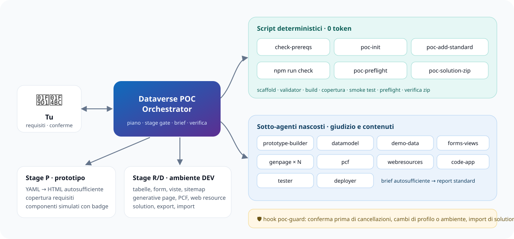

## dataverse-poc-agents

Marketplace di plugin per agenti GitHub Copilot (VS Code e Copilot CLI) dedicati alle **POC su Dataverse e Power Platform**: dal requisito al prototipo navigabile in stile Dynamics 365, fino alla realizzazione in un ambiente DEV, con un orchestratore, dieci sotto-agenti specializzati e script deterministici per tutto il lavoro meccanico.

🌐 Sito del progetto: <https://raythekool.github.io/dataverse-poc-agents/> · 📘 Tutorial: [docs/tutorial-init.md](docs/tutorial-init.md)



| Plugin | Versione | Descrizione |
| --- | --- | --- |
| [dataverse-poc](plugins/dataverse-poc/README.md) | 1.1.0 | Orchestratore multi-agente per POC: init in un comando, prototipo HTML/YAML con renderer generico, datamodel, dati demo, form/viste/sitemap, generative page, PCF, web resource, code app, test, deploy |

### Avvio rapido

```powershell
# 1. requisiti della postazione (sola lettura)
node plugins/dataverse-poc/scripts/check-prereqs.mjs
# 2. una POC model-driven con la baseline Sales Hub, dati sintetici e piano
node plugins/dataverse-poc/scripts/poc-init.mjs --root POC/OrderService --app-type model-driven --prefix ava_ --name "Order Service" --hub sales-hub --initiative Ordini --client Contoso
# 3. apri il prototipo (Windows; altrove aprire il file dal file manager)
start POC/OrderService/dist/ava_order_service.html
```

Dalla chat: agente **Dataverse POC Orchestrator** → `init`.

### Struttura

```text
.github/plugin/marketplace.json   # elenco plugin del marketplace
.github/workflows/                # validate (validator + test) e pages (sito)
plugins/dataverse-poc/
  plugin.json                     # manifest (formato Copilot)
  hooks.json                      # hook PreToolUse poc-guard
  agents/                         # orchestratore + sotto-agenti poc-*
  skills/                         # skill dataverse-poc-* e prototype-dataverse-app (template pipeline, renderer, asset)
  scripts/                        # poc-guard, check-prereqs, poc-init, poc-add-standard, poc-preflight, poc-solution-zip
docs/                             # tutorial e immagini condivise con il sito
site/                             # sorgenti del sito GitHub Pages
scripts/validate-plugin.mjs       # validazione strutturale
scripts/build-site.mjs            # build del sito in _site/
tests/                            # node:test degli script e flusso end-to-end
```

### Sviluppo

```powershell
node scripts/validate-plugin.mjs          # manifest, frontmatter, link, script referenziati, sintassi JS
node --test tests/scripts.test.mjs        # test degli script + scaffold end-to-end (SKIP_E2E=1 per saltarlo)
node scripts/build-site.mjs --out _site   # anteprima del sito
```

Il validator controlla manifest, frontmatter di skill e agenti (`name` uguale alla cartella), sotto-agenti referenziati in `agents:`, link Markdown relativi, script del plugin citati da agenti e skill, script del hook e sintassi di tutti i file JavaScript.

Prima di ogni rilascio aggiornare `version` sia in `plugins/<plugin>/plugin.json` sia in `.github/plugin/marketplace.json`, e il `CHANGELOG.md` del plugin: senza bump di versione VS Code non propone l'aggiornamento.

Non inserire nomi di clienti, URL di ambiente, app id, connection id o segreti: il plugin e condiviso fra progetti.
